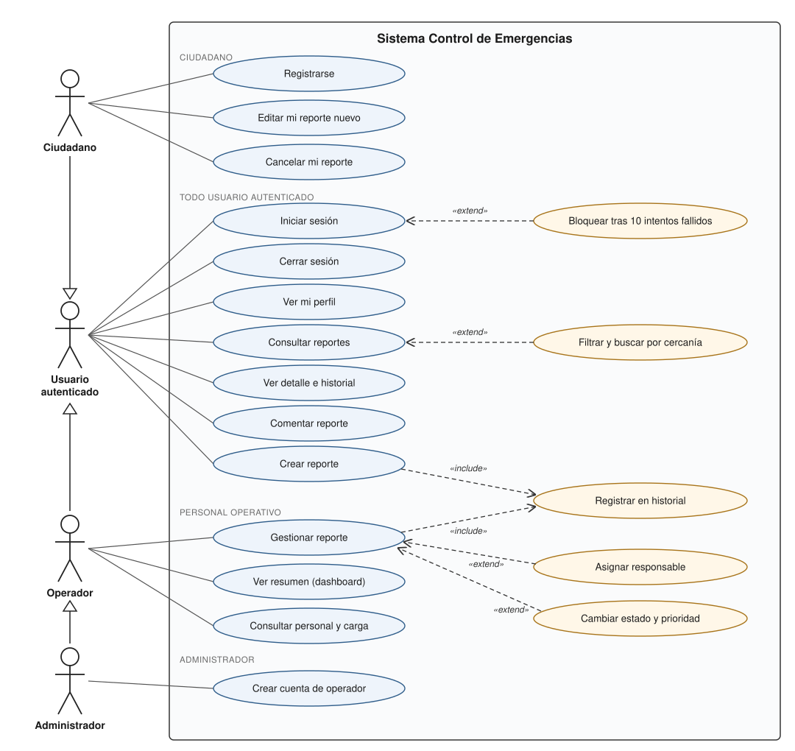

# Diagrama de casos de uso

- Imagen: [diagramas/casos-de-uso.svg](diagramas/casos-de-uso.svg) (también en [PNG](diagramas/casos-de-uso.png) para documentos y diapositivas).
- Fuente PlantUML: [diagramas/casos-de-uso.puml](diagramas/casos-de-uso.puml). Se puede abrir en [plantuml.com](https://www.plantuml.com/plantuml) o con la extensión PlantUML de VS Code. Si se cambia el diagrama, actualizar también el SVG y el PNG.

## Actores

| Actor | Descripción |
|---|---|
| Usuario autenticado | Cualquier persona con sesión iniciada. Es el actor general del que heredan los demás. |
| Ciudadano | Se registra por su cuenta y reporta emergencias. Solo ve y edita sus propios reportes. |
| Operador | Personal operativo. Ve todos los reportes, los asigna, cambia su estado y prioridad y consulta el dashboard. |
| Administrador | Hace todo lo que hace un operador y además crea cuentas de operador. Se crea desde el archivo `.env`. |

## Casos de uso

| Caso de uso | Actor | Ruta | Descripción |
|---|---|---|---|
| Registrarse | Ciudadano | `POST /api/auth/register` | Crea una cuenta con rol ciudadano y devuelve el token. |
| Editar mi reporte nuevo | Ciudadano | `PATCH /api/incidents/:id` | Cambia los datos de su reporte solo mientras esté en estado `new`. |
| Cancelar mi reporte | Ciudadano | `PATCH /api/incidents/:id` | Pasa su reporte a `cancelled` mientras esté en estado `new`. |
| Iniciar sesión | Usuario autenticado | `POST /api/auth/login` | Valida correo y contraseña y devuelve un token JWT. |
| Cerrar sesión | Usuario autenticado | `POST /api/auth/logout` | Revoca el token actual. |
| Ver mi perfil | Usuario autenticado | `GET /api/auth/me` | Muestra los datos del usuario de la sesión. |
| Consultar reportes | Usuario autenticado | `GET /api/incidents` | Lista paginada. El ciudadano solo ve los suyos. |
| Ver detalle e historial | Usuario autenticado | `GET /api/incidents/:id`, `GET /api/incidents/:id/history` | Muestra un reporte y la lista de sus cambios. |
| Comentar reporte | Usuario autenticado | `GET` y `POST /api/incidents/:id/comments` | Lee y escribe comentarios en un reporte que el usuario puede ver. |
| Crear reporte | Usuario autenticado | `POST /api/incidents` | Registra una emergencia en estado `new`. Solo el personal puede fijar la prioridad. |
| Gestionar reporte | Operador | `PATCH /api/incidents/:id` | Actualiza un reporte abierto. |
| Ver resumen (dashboard) | Operador | `GET /api/dashboard/summary` | Totales por estado y prioridad, reportes de hoy y asignados al usuario. |
| Consultar personal y carga | Operador | `GET /api/users` | Lista el personal operativo con su número de reportes abiertos. |
| Crear cuenta de operador | Administrador | `POST /api/users` | Crea una cuenta con rol operador. |

## Inclusiones y extensiones

| Relación | Caso | Descripción |
|---|---|---|
| «extend» de Iniciar sesión | Bloquear tras 10 intentos fallidos | Tras 10 intentos fallidos desde la misma IP en 15 minutos, responde 429. |
| «extend» de Consultar reportes | Filtrar y buscar por cercanía | Filtros opcionales: estado, prioridad, categoría, texto, fechas y cercanía (`near`, `radius`). |
| «include» de Crear reporte y Gestionar reporte | Registrar en historial | Cada creación o cambio guarda quién lo hizo y qué campos cambiaron. |
| «extend» de Gestionar reporte | Asignar responsable | Asignar un operador pasa el reporte a `assigned`; quitarlo lo devuelve a `new`. |
| «extend» de Gestionar reporte | Cambiar estado y prioridad | Solo se permiten transiciones válidas (por ejemplo, no se pasa de `new` a `resolved` sin pasar por `in_progress`). Un reporte `resolved` o `cancelled` no se puede reabrir. |
